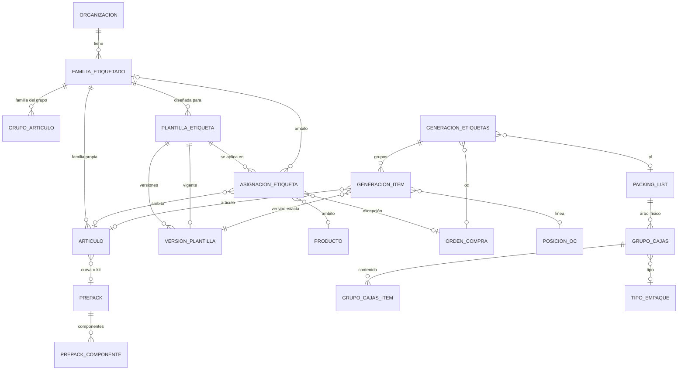
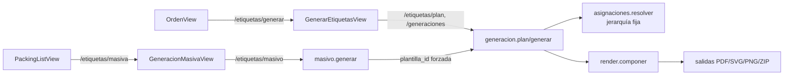
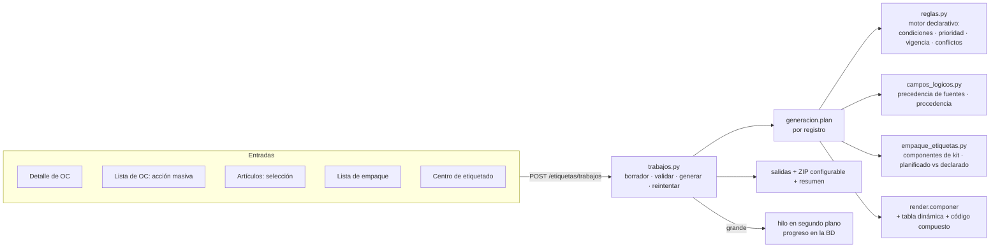

# Etiquetado genérico: auditoría, rediseño e implementación

Este documento sigue el orden pedido: **auditar → documentar → diseñar →
validar el plan → implementar → migrar → probar → documentar**. Las
secciones 1 a 9 se escribieron antes de modificar el código. La sección 10
(entrega) se completó después, solo con lo comprobado.

`docs/ETIQUETADO.md` sigue siendo el manual del módulo (editor, versiones,
formatos). Este documento cubre el rediseño: reglas, campos, empaque,
trabajos y puntos de entrada.

---

## 1. Inventario (estado al empezar, rama `main` fusionada en a39157a)

| Capa | Archivo | Qué hace |
|---|---|---|
| Modelo | `backend/app/modelos/etiquetado.py` | `FamiliaEtiquetado`, `PlantillaEtiqueta`, `VersionPlantilla`, `AsignacionEtiqueta`, `GeneracionEtiquetas`, `GeneracionItem` |
| Migraciones | `alembic/versions/0070_etiquetado.py`, `0071_etiquetado_masivo.py` | Tablas, RLS, FK de coherencia por organización; familia por grupo de artículos; `pl_id` y `lote` en generaciones |
| Campos | `modulos/etiquetado/campos.py`, `datos_campos.py` | Catálogo fijo por grupo (oc, linea, articulo, producto, bulto, organizacion, etiqueta) + atributos de variante + campos propios; valores reales; bultos de las listas de empaque |
| Datos | `datos.py` | Carga OC, línea y artículo dentro del alcance del usuario; arma los valores |
| Diseño | `diseno.py` | Esquema Pydantic del diseño (texto, campo, imagen, código, rect, elipse, línea), hoja, variables manuales |
| Dibujo | `render.py`, `salidas.py`, `codigos.py`, `fuentes.py` | Un solo cálculo de primitivas; PDF, SVG y PNG; validación por simbología; tamaño mínimo del módulo; contraste |
| Plantillas | `plantillas.py` | CRUD, duplicar, versiones con aprobación y concurrencia (`version`), imágenes |
| Familias | `familias.py` | CRUD, campos obligatorios, asignación a artículos y grupos |
| Asignaciones | `asignaciones.py` | Dónde se aplica cada diseño y `resolver()` |
| Generación | `generacion.py` | `plan()` / `generar()` / `archivo()` / historial |
| Masiva | `masivo.py` | Lotes por OC, artículos o nivel de empaque de una lista de empaque, con **un** diseño elegido |
| Vista previa | `previa.py` | SVG del servidor, miniaturas, `/resolver` |
| API | `api.py` | 40 rutas bajo `/api/etiquetas` |
| Frontend | `frontend/src/modulos/etiquetado/` | Centro (`EtiquetasView`), editor (11 componentes), `GenerarEtiquetasView` (asistente de 4 pasos), `GeneracionMasivaView` (5 pasos), familias, asignaciones, historial |
| Entradas | `OrdenView.vue:180`, `PackingListView.vue:538`, pestaña de producto (`EtiquetadoProducto.vue`) | Botones a `/etiquetas/generar` y `/etiquetas/masiva` |
| Pruebas | `tests/test_etiquetado_{familias,generacion,masivo,plantillas,render}.py` | 35 pruebas |
| Datos de empaque reutilizables | `modelos/empaque.py` (`GrupoCajas`, `GrupoCajasItem`, `TipoEmpaque`, `PlantillaCaja`), `modelos/maestros.py` (`Prepack`, `PrepackComponente`), `modelos/compras.py` (`PosicionOC.casepack/inner_pack/prepack/unidades_por_caja`) | Árbol físico del PL, tipos de empaque configurables, curvas y kits, empaque planificado en la OC |
| Numeración | `core/numeracion.py` (`SerieDocumental`, `ContadorSerie`) | Series con contador bloqueado: base del servicio controlado de identificadores |

## 2. Modelo entidad-relación actual

## 3. Arquitectura

Antes:

Después (implementado):

Las rutas anteriores (`/etiquetas/plan`, `/etiquetas/generaciones`,
`/etiquetas/masivo`) se conservan y usan **el mismo** motor de reglas,
campos y dibujo: no hay dos caminos de resolución.

## 4. Problemas verificados (con evidencia)

| # | Problema | Evidencia |
|---|---|---|
| P1 | Jerarquía de prioridad fija en código; sin condiciones por valor de campo, prioridad numérica, vigencia ni nombre de regla | `asignaciones.py:162` `NIVELES = ("OC", "ARTICULO", "PRODUCTO", "FAMILIA", "GENERAL")` |
| P2 | La generación masiva usa **un** diseño para todo, sin resolver por registro | `masivo.py:109-125` exige `plantilla_id` y lo pasa forzado a `generacion.plan` |
| P3 | Sin prueba de reglas con explicación ni detección estática de conflictos (solo «elige tú» al generar) | `asignaciones.py:222-227`; `/etiquetas/resolver` no explica las reglas descartadas |
| P4 | Sin precedencia de fuentes por campo: UPC de la línea vs del artículo, país de la línea vs de la OC vs del producto son campos distintos sin regla ni procedencia | `campos.py:96-101, 105, 122` |
| P5 | No hay tabla dinámica; el contenido de un bulto es un texto plano, y un kit o curva no expone sus componentes | `diseno.py:69` (tipos de elemento); `campos.py:325` (`"; ".join(...)`) |
| P6 | Con contenido mixto, la etiqueta toma la primera línea | `generacion.py:215` |
| P7 | El valor de un código es una plantilla de texto: sin separador explícito, transformaciones validadas ni verificación de lectura al generar | `diseno.py:96`; `render.py:_codigo` |
| P8 | Sin identificadores controlados (serie) para etiquetas | No existe ningún uso de `numeracion` en `etiquetado/` |
| P9 | Sin subfamilias | `modelos/etiquetado.py:45-60` (sin `padre_id`) |
| P10 | No se compara el empaque planificado (OC) con el declarado (PL) | `campos.py:_unidades` lee el PL; no consulta `PosicionOC.casepack/inner_pack` |
| P11 | Sin trabajos persistentes: no hay borradores, recuperación, registros por trabajo, reintentos, generación parcial configurable, progreso ni procesamiento asíncrono | `generacion.generar` es síncrono y limitado a `ETIQUETAS_MAXIMO_LOTE` (`config.py:129`); `masivo.py:36-37` |
| P12 | ZIP con estructura fija (`png/`, `svg/`) sin carpetas ni nombres configurables | `generacion.py:_producir` |
| P13 | No se distingue generado, descargado e impreso | Solo `registrar(..., "descargar")` en la bitácora |
| P14 | Puntos de entrada distintos con lógica distinta; no hay acción masiva en la lista de OC ni selección desde artículos | `OrdenView.vue:180` → `/etiquetas/generar`; `PackingListView.vue:538` → `/etiquetas/masiva` |

## 5. Matriz de reutilización

| Elemento | Clasificación | Decisión y motivo |
|---|---|---|
| `render.py` (componer, texto, códigos, contraste, módulo mínimo) | Reutilizable con cambios | Se agrega el elemento `tabla` y el valor compuesto de códigos; el resto no cambia |
| `salidas.py` (PDF/SVG/PNG) | Reutilizable | Dibuja primitivas; la tabla se compone de primitivas existentes |
| `codigos.py` | Reutilizable | — |
| `diseno.py` | Reutilizable con cambios | Nuevos tipos `tabla`, `partes` y `separador` del código, nuevos operadores de condición |
| `plantillas.py` (versiones, aprobación, concurrencia) | Reutilizable | Ya cumple versiones, aprobación, duplicar y bitácora |
| `campos.py` | Reutilizable con cambios | Se agregan las colecciones (`bulto.lineas`, `bulto.componentes`, `articulo.componentes`), `bulto.tipo_codigo`, `articulo.familia_ruta`, los campos de contexto y los campos lógicos al catálogo |
| `datos_campos.py` | Reutilizable con cambios | Origen y ejemplo de los campos nuevos |
| `familias.py` | Reutilizable con cambios | `padre_id`, herencia de campos obligatorios, sin ciclos |
| `asignaciones.py` | Reutilizable con cambios | **Evoluciona a reglas** sin perder datos: misma tabla con nombre, prioridad, condiciones, contexto y vigencia; `resolver()` pasa a `reglas.py` |
| `generacion.py` | Reutilizable con cambios | `plan()` sigue siendo el único cálculo por registro; agrega campos lógicos, empaque y procedencia |
| `masivo.py` | Duplicado parcial | Se conserva (API pública y pruebas) pero su resolución pasa por el mismo motor; el diseño elegido es opcional (sin él, regla por registro) |
| `previa.py` | Reutilizable | `/resolver` delega en el motor nuevo |
| `GenerarEtiquetasView.vue` y `GeneracionMasivaView.vue` | Duplicados | Reemplazados por un solo asistente de trabajos; las rutas viejas redirigen al nuevo |
| `AsignacionesEtiqueta.vue` | Reutilizable con cambios | Pasa a editor de reglas con condiciones, prioridad, vigencia, probador y conflictos |
| Editor (`editor/*`) | Reutilizable con cambios | Panel y lienzo para la tabla; compositor del código |
| `HistorialEtiquetas.vue` | Reutilizable con cambios | Estados descargado e impreso |
| `Prepack`/`PrepackComponente`, `GrupoCajas`, `TipoEmpaque`, `PosicionOC.casepack/inner_pack` | Reutilizables | Fuente de componentes y del empaque planificado; no se duplican |
| `core/numeracion.py` | Reutilizable con cambios | `reservar()` de un bloque de números para identificadores de etiqueta |
| Faltantes | Faltante | Trabajos y registros, campos lógicos, subfamilias, tabla, código compuesto, verificación de lectura, ZIP configurable, impresión confirmada, acción masiva en la lista de OC |
| Obsoleto | — | Nada se borra: tablas, columnas y rutas siguen. `ambito` de las asignaciones se mantiene como el destino de la regla |

## 6. Propuesta funcional y de experiencia de uso

**Un solo asistente de trabajo** (`/etiquetas/trabajos/:id`) con 8 pasos:

1. **Origen.** OC (una o varias), artículos o lista de empaque.
2. **Registros.** Líneas, artículos o niveles de empaque. Qué representa cada etiqueta y cuántas.
3. **Empaque.** Nivel del árbol, comparación de lo planificado (OC) con lo declarado (PL) y componentes de kits.
4. **Reglas y diseños.** Diseño elegido por registro, con la regla y el motivo. Conflictos para resolver y forzado opcional con motivo.
5. **Vista previa.** Dibujo del servidor con los datos reales de cualquier registro.
6. **Errores.** Clasificados como error, advertencia, dato opcional vacío, conflicto o inconsistencia de empaque, por registro, con filtro.
7. **Generar.** Formato, carpetas y nombres del ZIP. Generación parcial si la empresa la permite.
8. **Descargas e historial.** Ejecuciones del trabajo, descarga, confirmación de impresión y reintento de los registros omitidos.

Comportamiento del asistente:

- Cada paso se guarda en el servidor (borrador). Al salir y volver, el asistente sigue en el mismo paso.
- Los borradores aparecen en el centro de etiquetado.
- Todas las entradas (OC, lista de OC, artículos, lista de empaque, centro) crean un trabajo con el mismo servicio.
- Las rutas `/etiquetas/generar` y `/etiquetas/masiva` abren el asistente con el origen ya puesto.

**Reglas.** Cada regla tiene:

- Nombre, diseño, prioridad (número), destino (opcional) y condiciones sobre campos del catálogo.
- Contexto: tipo de trabajo (OC, artículo, OC-artículo), origen, unidad y nivel de empaque.
- Vigencia (desde/hasta) y estado activa.

Tiene un **probador** que recibe un registro real (OC, línea, artículo, bulto) o valores de muestra y explica regla por regla por qué aplica o no. Hay también un panel de **conflictos**: reglas con la misma prioridad que pueden coincidir y llevan a diseños distintos.

**Campos lógicos.** Por ejemplo, «UPC» = primero `linea.upc`, después `articulo.upc`. Cada uno tiene una política ante fuentes con valores distintos: usar la primera, advertir o bloquear. Se definen en el centro de etiquetado y se usan en los diseños como `logico.upc`. La instantánea guarda de qué fuente salió cada valor.

## 7. Modelo de datos propuesto

| Tabla | Cambio |
|---|---|
| `familias_etiquetado` | `padre_id` (FK a sí misma y FK de coherencia por organización) |
| `asignaciones_etiqueta` (reglas) | `nombre`, `prioridad`, `condiciones` (JSON validado), `contexto` (JSON), `vigente_desde`, `vigente_hasta`, `actualizada_en`, `actualizada_por`, `version`. `ambito` admite `REGLA` (solo condiciones) |
| `campos_etiqueta` (nueva) | Campos lógicos por organización: `clave`, `etiqueta`, `tipo`, `fuentes` (lista ordenada de campos del catálogo), `politica` (PRIMERA, ADVERTIR, BLOQUEAR), `modalidades`, `activo` |
| `trabajos_etiqueta` (nueva) | `nombre`, `origen`, `estado` (BORRADOR, VALIDADO, EN_PROCESO, GENERADO, PARCIAL, ERROR, CANCELADO), `paso`, `parametros` (JSON), `resumen` (JSON), `progreso`, `total`, `error`, `version` (concurrencia), `creado_por/en`, `actualizado_en` |
| `trabajo_etiqueta_registros` (nueva) | Uno por grupo validado: `trabajo_id`, `clave`, `referencia`, `oc_id`, `posicion_id`, `articulo_id`, `pl_id`, `plantilla_id`, `version_id`, `regla_id`, `cantidad`, `estado` (LISTO, ADVERTENCIA, ERROR, GENERADO, OMITIDO), `problemas` (JSON), `motivo`, `generacion_id` |
| `generaciones_etiqueta` (ejecuciones) | `trabajo_id`, `descargas`, `descargada_en`, `impresa_en`, `impresa_por`, `impresion` (JSON con la confirmación) |

- Todas las tablas nuevas llevan `organizacion_id`, RLS y FK de coherencia `(id, organizacion_id)`.
- Las restricciones se declaran en `restricciones.py` y `referencias.py`.
- Elemento `tabla` en el diseño:
  - `coleccion` y `columnas` [{`campo`, `titulo`, `ancho`, `alin`, `formato`}].
  - `encabezado` y `totales` (lista de columnas que suman).
  - `desborde`: `error`, `reducir` o `resumir`. `resumir` muestra «… y N más» y deja una advertencia. Nunca se corta en silencio.
- Elemento `codigo`:
  - `partes` [{`campo` | `fijo` | `serie`, `transformar`: mayus, solo_digitos, sin_espacios, `rellenar` (n, carácter), `recortar`}] y `separador`.
  - `verificar` (decodificar al validar).

## 8. Plan de migración

Migración `0073_etiquetado_generico`:

1. **Familias.** Agrega `padre_id` (nulo: las familias existentes quedan como raíz).
2. **Reglas.** Agrega las columnas y convierte cada asignación existente en regla equivalente:
   - Prioridad por ámbito: OC 500, ARTICULO 400, PRODUCTO 300, FAMILIA 200, GENERAL 100.
   - `nombre` = «ámbito: destino»; condiciones vacías; `contexto` vacío (todas).
   - `predeterminada` se conserva y desempata solo dentro de la misma prioridad, como antes.
   - Resultado: el mismo diseño se elige para los mismos datos que antes de migrar. Lo comprueba una prueba de actualización.
3. **Tablas nuevas.** Crea `campos_etiqueta`, `trabajos_etiqueta` y `trabajo_etiqueta_registros` con RLS.
4. **Generaciones.** Agrega `trabajo_id` y las columnas de descarga e impresión.
5. **Permisos.** `etiquetas.reglas` y `etiquetas.campos` para los roles de sistema admin e interno.
6. **Errores de datos.** No detienen la migración: se anotan y se corrigen, según la política de ebb764a.

`downgrade()` revierte las columnas y tablas. Las reglas convertidas siguen siendo asignaciones válidas, porque el ámbito y el destino no cambian.

## 9. Plan de pruebas

| Área | Prueba |
|---|---|
| Reglas | Condiciones (igual, en, contiene, mayor, existe…), prioridad, vigencia, contexto, destino y condiciones juntos; empate → conflicto sin elegir; predeterminada desempata; probador explica; conflictos estáticos |
| Familias | Subfamilia hereda campos obligatorios y la regla de la familia padre; ciclo rechazado |
| Campos lógicos | Precedencia, procedencia en la instantánea, política ADVERTIR y BLOQUEAR |
| Kits y empaque | Componentes de prepack en la tabla; varios niveles; planificado vs declarado (casepack distinto → advertencia); no inventa cantidades |
| Tabla | Columnas, totales, desborde `error` / `resumir` (advertencia, nunca silencioso) |
| Códigos | Compuesto con separador y transformaciones; serie controlada sin repetición; se decodifican (zxing-cpp) con el valor esperado |
| Faltantes | Dato obligatorio vacío → error; opcional vacío → aviso clasificado |
| OC mixta | Una OC con dos familias → dos diseños en el mismo trabajo |
| Entradas | Trabajo desde OC, varias OC, artículos, lista de empaque: mismo servicio, mismas reglas |
| ZIP | Carpetas y nombres configurables, sin colisiones, resumen dentro |
| Parcial y reintento | Genera solo los listos si la empresa lo permite; reintentar genera los omitidos tras corregir |
| Versiones e instantáneas | Re-descarga idéntica tras cambiar datos o diseño |
| Seguridad | Permisos por operación, proveedor sin acceso a trabajos ajenos, aislamiento entre organizaciones, idempotencia, concurrencia (409) |
| Migraciones | Instalación nueva (`alembic check`) y actualización desde 0072 con asignaciones existentes |
| Regresión | Suite completa del backend y pruebas e2e del frontend |
| Navegador | Asistente en escritorio y celular |

## 9 bis. Archivos

Nuevos:

- `backend/app/modulos/etiquetado/reglas.py`
- `backend/app/modulos/etiquetado/campos_logicos.py`
- `backend/app/modulos/etiquetado/empaque_etiquetas.py`
- `backend/app/modulos/etiquetado/trabajos.py`
- `backend/alembic/versions/0073_etiquetado_generico.py`
- `backend/tests/test_etiquetado_reglas.py`
- `backend/tests/test_etiquetado_trabajos.py`
- `backend/tests/test_etiquetado_contenido.py`
- `frontend/src/modulos/etiquetado/vistas/TrabajoEtiquetasView.vue`
- `frontend/src/modulos/etiquetado/componentes/CamposEtiqueta.vue`
- `frontend/src/modulos/etiquetado/componentes/TrabajosEtiqueta.vue`

Modificados:

- Backend: `modelos/etiquetado.py`, `restricciones.py`, `referencias.py`, `campos.py`, `datos_campos.py`, `diseno.py`, `render.py`, `asignaciones.py`, `generacion.py`, `masivo.py`, `familias.py`, `api.py`, `core/numeracion.py`, `acceso/permisos.py`.
- Frontend: `router.js`, `EtiquetasView.vue`, `PanelElemento.vue`, `ElementoSvg.vue`, `OrdenesView.vue`, `OrdenView.vue`, `PackingListView.vue`, `FamiliasEtiquetado.vue`, `ArticulosFamilia.vue`, i18n.
- El editor de reglas quedó en `AsignacionesEtiqueta.vue` (reescrito, mismo archivo) en lugar de un `ReglasEtiqueta.vue` nuevo: la pestaña y los enlaces existentes (`?vista=asignaciones`) siguen sirviendo.

---

## 10. Entrega (después de implementar; solo lo comprobado)

### 10.1 Resumen de cambios

- **Motor de reglas declarativo** (`reglas.py`). Las asignaciones pasan a ser reglas:
  - Nombre, prioridad numérica y destino opcional (familia con subfamilias, producto, artículo, OC o ninguno).
  - Condiciones sobre cualquier campo del catálogo, con 17 operadores de una lista cerrada; no hay código de usuario.
  - Contexto (modalidad, origen, unidad, tipo de empaque), vigencia y control de concurrencia (`version`).
  - Empate entre diseños distintos con la misma prioridad = conflicto. Se resuelve solo con la elección del usuario o una única predeterminada.
  - Detección estática de conflictos y probador con explicación regla por regla, con registros reales, valores de muestra, fecha y una regla en borrador.
- **Campos lógicos** (`campos_logicos.py`):
  - Fuentes en orden de precedencia.
  - Política ante valores distintos: PRIMERA, ADVERTIR o BLOQUEAR.
  - Se usan como `logico.<clave>` y la instantánea guarda la procedencia (`_procedencia`).
- **Subfamilias**:
  - `padre_id` sin ciclos.
  - Herencia de campos obligatorios y de las reglas FAMILIA.
  - Operador `en_familia` sobre `articulo.familia_ruta`.
- **Contenido y empaque**:
  - Colecciones `bulto.lineas`, `bulto.componentes` (prepacks y kits desglosados por componente), `articulo.componentes` y `oc.lineas`.
  - Comparación de lo planificado (casepack e inner pack de la OC) con lo declarado en el PL.
  - Un prepack sin componentes no se reparte: se avisa. No se inventan cantidades.
- **Elemento tabla**:
  - Columnas, encabezado, alineación, formato y totales. Los totales suman todas las filas; si a una fila le falta el número, se avisa.
  - Desborde `error`, `reducir` o `resumir` (siempre con error o advertencia, nunca en silencio). Celdas que no caben: «…» con advertencia.
- **Códigos compuestos**:
  - Partes (campo o texto fijo) con transformaciones (mayúsculas, minúsculas, solo dígitos, sin espacios, alfanumérico), relleno, recorte y separador.
  - Identificador controlado `etiqueta.serie`: serie de numeración de objeto «etiqueta». Se reserva un bloque por grupo al generar y se reproduce idéntico al volver a descargar.
  - Verificación de lectura con zxing-cpp sobre una etiqueta dibujada por diseño (hasta 20 por trabajo).
- **Trabajos de etiquetado** (`trabajos.py`):
  - Borrador con paso guardado y validación por registro en el servidor.
  - Errores clasificados en 10 categorías.
  - Generación completa o parcial (regla de empresa), con reintento de lo pendiente.
  - Segundo plano con avance desde `ETIQUETAS_ASINCRONO_DESDE`, recuperable si el proceso se interrumpe.
  - ZIP con carpetas y nombres configurables, sin colisiones, con `summary.json` y `summary.csv`.
  - Generado, descargado e impreso se distinguen. Impreso solo con confirmación expresa, después de descargar.
- **Generación masiva**: el diseño ya no es obligatorio. Sin él, cada registro toma el de sus reglas.
- **Frontend**:
  - Asistente único de 8 pasos (`TrabajoEtiquetasView.vue`).
  - Pestañas nuevas en el centro de etiquetado: Trabajos, Reglas (editor con probador y conflictos) y Campos lógicos.
  - Editor de diseños con tabla, compositor de código y condiciones con todos los operadores.
  - Familia superior en el formulario de familias.
  - Entradas: detalle de OC, acción masiva en la lista de OC, lista de empaque, selección de artículos, familia, pestaña del producto y centro. Las rutas `/etiquetas/generar` y `/etiquetas/masiva` redirigen al asistente.

### 10.2 Archivos

**Nuevos — backend**
- Servicios: `modulos/etiquetado/{reglas,campos_logicos,empaque_etiquetas,trabajos,verificacion}.py`
- Migración: `alembic/versions/0073_etiquetado_generico.py`
- Pruebas: `tests/test_etiquetado_{reglas,contenido,trabajos}.py`

**Nuevos — frontend**
- `vistas/TrabajoEtiquetasView.vue`
- `componentes/TrabajosEtiqueta.vue`
- `componentes/CamposEtiqueta.vue`

**Modificados — backend**
- `modelos/{etiquetado,__init__,restricciones,referencias}.py`
- `modulos/etiquetado/{api,asignaciones,campos,datos_campos,diseno,familias,generacion,masivo,plantillas,render}.py`
- `core/{numeracion,empresa,config}.py`
- `modulos/acceso/permisos.py`, `modulos/maestros/catalogos.py` (objeto de serie «etiqueta»)
- `requirements*.txt`: zxing-cpp pasa a dependencia de ejecución.

**Modificados — frontend**
- Router, `estados.js`, `etiquetas.js` y el centro de etiquetado.
- Editor: `PanelElemento`, `ElementoSvg`, `BibliotecaCampos`, `CapasEtiqueta`, `estado.js`, `EditorEtiquetaView`.
- `AsignacionesEtiqueta.vue` (reescrito como editor de reglas), `FamiliasEtiquetado`, `ArticulosFamilia`, `EtiquetadoProducto`.
- `OrdenView`, `OrdenesView`, `PackingListView`.
- i18n y `e2e/recorrido.mjs`.

**Retirados** (sin referencias; las rutas redirigen al asistente)
- `vistas/GenerarEtiquetasView.vue`
- `vistas/GeneracionMasivaView.vue`

### 10.3 Tablas y migraciones

Migración `0073` (revisa `0072`). Se comprobó:

- **Instalación desde cero**: `alembic upgrade head` y `alembic check` («No new upgrade operations detected»); también `test_migraciones_al_dia_con_los_modelos` en la suite.
- **Actualización con datos**: la prueba `test_migracion_convierte_asignaciones_en_reglas_equivalentes` sube a 0072, inserta asignaciones GENERAL y FAMILIA y sube a head. Resultado: prioridades 100 y 200, nombre, condiciones `[]`, contexto `{}`, `predeterminada` conservada y familias sin padre.
- **Reversión**: `downgrade 0072` funciona; quita las reglas sin destino (no existían antes).

### 10.4 Pruebas ejecutadas (resultado real)

- `tests/test_etiquetado_*.py`: **56 aprobadas** al terminar el backend, más 1 nueva (trabajo interrumpido). Incluyen las 41 anteriores sin cambios: las asignaciones antiguas siguen eligiendo el mismo diseño.
- Suite completa del backend: **630 aprobadas, 3 omitidas, 0 fallidas**. Las omitidas requieren PostgreSQL: bloqueo de filas, contador y RLS.
- `npx eslint src e2e` sin errores; `vite build` correcto.
- Navegador (Chromium, demo con `SEED_DEMO=1`):
  - Asistente recorrido de punta a punta desde dos OC: registros → empaque → reglas (diseño y motivo por registro) → vista previa del servidor (código «PO-…» compuesto y tabla con total) → errores clasificados → generar → descargas.
  - Centro con Reglas, Campos lógicos y Trabajos; editor con la tabla.
  - Celular (390 px): sin errores de JavaScript ni de API.
  - `npm run e2e` (4 usuarios, escritorio y celular): las únicas incidencias son `ERR_CERT_AUTHORITY_INVALID` al cargar fuentes de Google a través del proxy de este entorno. No hay errores de JavaScript ni respuestas 4xx/5xx.

### 10.5 Limitaciones verificadas y pendientes

- **Base de datos**:
  - Las pruebas corren en SQLite.
  - RLS y las llaves de coherencia en PostgreSQL se crean en la migración con el mismo mecanismo que las anteriores, pero aquí no se ejecutó la suite contra PostgreSQL (`TEST_DATABASE_URL`).
- **Segundo plano**:
  - Es un hilo del mismo proceso, no una cola durable.
  - Si el proceso se reinicia, el trabajo se puede retomar después de 10 minutos sin avance; lo ya generado se conserva.
  - Con varios procesos de servidor, el bloqueo de doble ejecución es por proceso.
- **Verificación de lectura**: se hace sobre una muestra (una etiqueta por diseño, hasta 20), no sobre cada etiqueta.
- **Desborde de tablas**: no existe «continuar en otra etiqueta». Las opciones son error, reducir o resumir.
- **Idioma**: no hay variantes de idioma por diseño. Se crea un diseño por idioma y se elige con una regla (p. ej., condición sobre `oc.pais_origen` o un campo propio).
- **Impresión**: se registra la confirmación de quien imprimió. No hay integración con impresoras ni ZPL/EPL.
- **Selección de líneas**: con más de 5 OC en un trabajo se etiquetan todas sus líneas abiertas; para elegir líneas hay que usar menos OC.
- **Fuera de este trabajo**: siguen pendientes los puntos C3 (costos logísticos definibles), C5, C6 (lead times guiados), C7 y C8 del pedido anterior.

### 10.6 Configuración

1. **Familias**: Centro de etiquetado → Familias. Una familia puede ser subfamilia de otra; hereda sus campos obligatorios y sus reglas.
2. **Diseños**: Centro de etiquetado → Diseños. Se crean, se envían a aprobación y se aprueban. En el editor, la «Tabla (lista de filas)» y el «Armar el valor por partes» del código.
3. **Reglas**: Centro de etiquetado → Reglas → Nueva regla.
   - Diseño, prioridad y destino o «Cualquier registro que cumpla las condiciones».
   - Condiciones, contexto y vigencia.
   - El panel «Probar las reglas» explica qué se elegiría. El aviso de conflictos aparece arriba de la tabla.
4. **Campos lógicos**: Centro de etiquetado → Campos lógicos. Fuentes en orden y política ante valores distintos. Se usan en el diseño como `{{logico.clave}}`.
5. **Identificador controlado**: Mantenimiento → Series de numeración, objeto «Labels (controlled label ID)». En el diseño, el campo `etiqueta.serie`.
6. **Reglas de empresa** (Configuración → Empresa):
   - `ETIQUETAS_GENERACION_PARCIAL` (falso por defecto).
   - `ETIQUETAS_ASINCRONO_DESDE` (2000).
   - `ETIQUETAS_MAXIMO_TRABAJO` (50000; solo en `config.py`).
7. **Permisos**:
   - `etiquetas.asignar`: reglas.
   - `etiquetas.campos`: campos lógicos (nuevo; dado a admin e interno por la migración).
   - `etiquetas.generar`: trabajos, descargas y confirmación de impresión. Un proveedor solo ve sus trabajos y sus OC.

### 10.7 Evidencia de no regresión

- Suite completa del backend con el código final: `630 passed, 3 skipped` (`pytest -rs`). Las 3 omitidas son las pruebas exclusivas de PostgreSQL.
- Las 41 pruebas de etiquetado anteriores al rediseño pasan sin cambios. Las asignaciones antiguas, ya convertidas en reglas, eligen el mismo diseño.
- `alembic check` sin diferencias.
- `eslint` y `vite build` sin errores.
- Recorrido e2e de todas las pantallas con 4 usuarios en escritorio y celular, sin errores de la aplicación.
